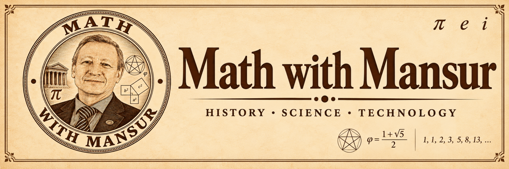

# Mathematics with Mansur

An illustrated online journal exploring the history of mathematics: the people, ideas, discoveries and problems that shaped the discipline.

Edited by Mansur Gilmullin, the journal brings together historical essays, mathematical explorations and problems for curious readers. Articles are available in English and Russian, with downloadable PDF editions.

[Read the journal →](https://fuzzy-technologies.github.io/history_math/)

- [Reading Room](https://fuzzy-technologies.github.io/history_math/publications/) — browse articles, problems and notes by topic.
- [Showcase](https://fuzzy-technologies.github.io/history_math/showcase/) — discover books and other publications.
- [Search](https://fuzzy-technologies.github.io/history_math/search/) — find articles by title, topic or words from the text.
- [About the Journal](https://fuzzy-technologies.github.io/history_math/about/) — meet the editor and learn about the journal.

[English edition](https://fuzzy-technologies.github.io/history_math/) · [Russian edition](https://fuzzy-technologies.github.io/history_math/ru/)
